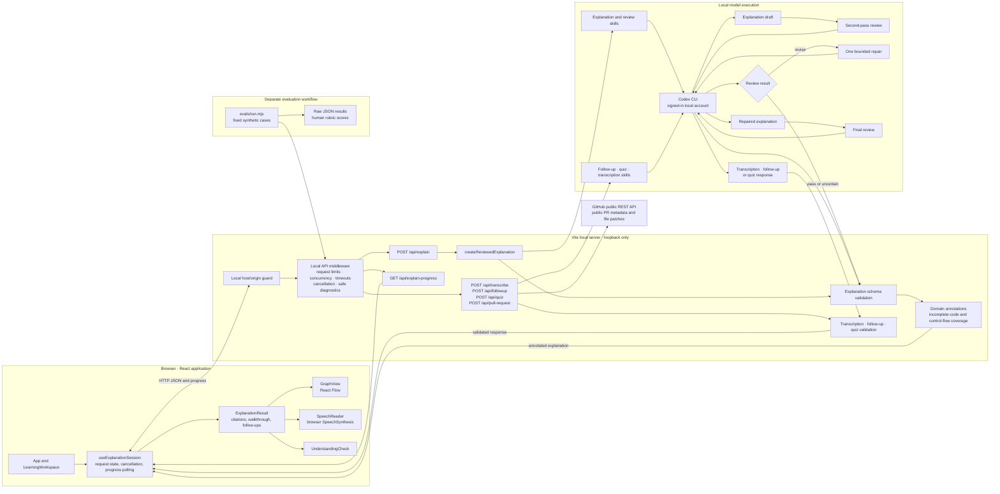

# Application architecture

This diagram describes the current local prototype and its request/data flow. The Vite middleware is the API server; there is no separate production backend or database.

## Main code areas

- `src/App.tsx` and `src/components/` compose the browser interface; `src/hooks/useExplanationSession.ts` coordinates explanation and follow-up requests.
- `src/server/local-api.ts` registers the local API routes, validates request boundaries, invokes the model runner, tracks progress, and emits privacy-safe diagnostics.
- `src/server/explanation-service.ts` builds explanation prompts and manages the bounded draft, review, repair, and final-review sequence.
- `src/server/github-pull-request.ts` validates public GitHub PR URLs and fetches bounded metadata and file patches for review in the input editor.
- `src/server/response-schemas.ts` and `src/server/response-validation.ts` define and validate structured model responses.
- `src/domain/` contains reusable types and transformations, including source-range handling, incomplete-code annotation, control-flow coverage, and generation phases.
- `skills/` holds task-specific model instructions; `evals/` holds the synthetic regression corpus and recorded evaluations.

## Trust and deployment boundary

The app is intended to run locally. Submitted text, follow-up context, and screenshot images are passed to the Codex CLI configured on the same machine; screenshots and intermediate request files use temporary storage and are removed after processing. The host/origin guard is not user authentication. Do not expose the Vite server to a network or treat this prototype as a multi-user service.
