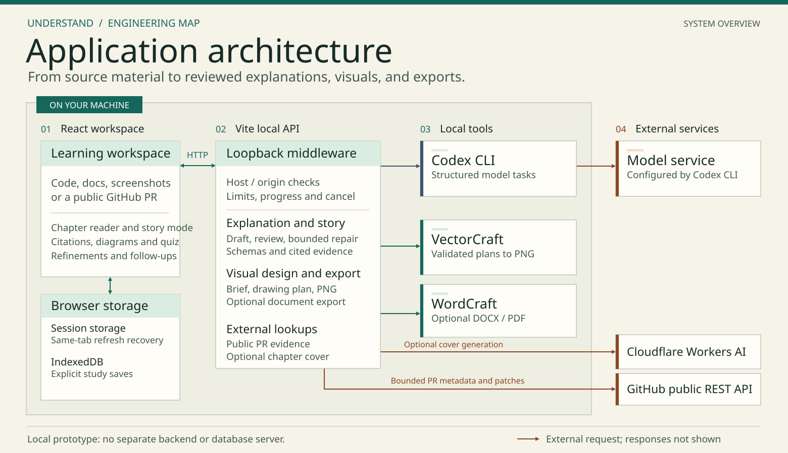

# Application architecture

Understand is a local prototype. React runs in the browser and talks to Vite
middleware over loopback HTTP. There is no separate backend or database server.

[Open the full-size SVG](understand-architecture.svg). The arrows show the main
request paths, not an execution trace. Only the browser/API and browser/storage
links show both directions.

## Runtime Flows

| Flow | What happens |
| --- | --- |
| Explain and refine | The browser submits source and learner preferences to the local API. The API loads task-specific instructions and calls Codex CLI. The explanation service validates structured output, runs a second-pass review with at most one repair, and adds source-linked annotations before returning the result. |
| Study a public PR | The API fetches bounded metadata and patches from GitHub. The workspace presents a chapter outline and generates individual explanations on request. It can fetch more patch evidence separately where coverage is incomplete. |
| Read a story | The selected chapter goes through a story draft and fidelity review. If a story does not pass the final check, the direct chapter remains available. |
| Build a visual | Codex can create a teaching brief and drawing plan. The local API validates the plan and calls VectorCraft to render PNG. React Flow renders the separate in-app interactive diagram. |
| Export a document | The optional local WordCraft adapter produces DOCX or PDF. Selected diagram images can also be rendered by the VectorCraft adapter. |
| Generate a chapter cover | The optional Cloudflare Workers AI route sends a preset theme prompt, not the chapter source. The result is a conceptual cover, not a diagram of code behavior. |

## Browser Storage

- **Session storage** checkpoints completed Code and Documentation explanations,
  their input, preferences, and reading position. Refresh restores the same tab
  without a model call. Invalid snapshots are discarded; clearing the input or
  disabling recovery removes the temporary copy.
- **IndexedDB** stores one explicitly saved study, including eligible PR studies,
  completed stories, variants, and accepted illustrations. Draft input,
  follow-up conversations, and quiz attempts are not part of a saved study.
- **Portable study files** are an explicit code/documentation import and export
  path. They can include original source; treat them as sensitive. They are not
  uploaded or used to regenerate content when imported.

## Main code areas

- `src/App.tsx` and `src/components/` compose the browser interface; `src/hooks/useExplanationSession.ts` coordinates explanation and follow-up requests.
- `src/server/local-api.ts` registers the local API routes, validates request boundaries, invokes the model runner, tracks progress, and emits privacy-safe diagnostics.
- `src/server/chapter-story-api.ts` handles on-demand story variants. Its service validates source ranges, uses a separate fidelity review with at most one repair, and returns no story when review cannot pass. It shares the local model request budget with other routes.
- Story scene visuals reuse the visual brief and VectorCraft planning/rendering
  routes. The factual mode sends the scene mapping without the story text;
  the brief service carries mode-specific guidance into the drawing plan.
- `src/server/visual-api.ts` registers visual brief, scene planning, PNG rendering, and chapter cover routes. It uses the same request concurrency limit, cancellation, and diagnostics as the explanation routes.
- `src/server/explanation-service.ts` builds explanation prompts and manages the bounded draft, review, repair, and final-review sequence.
- `src/server/github-pull-request.ts` validates public GitHub PR URLs and fetches bounded metadata and file patches for the PR workspace.
- `src/server/response-schemas.ts` and `src/server/response-validation.ts` define and validate structured model responses.
- `src/server/vectorcraft-export.ts` and `src/server/wordcraft-export.ts` adapt the optional local rendering and export tools.
- `src/domain/temporary-study.ts`, `src/domain/saved-study.ts`, and `src/domain/portable-study.ts` handle refresh recovery, local saves, and study transfer respectively.
- `src/domain/` contains reusable types and transformations, including source-range handling, incomplete-code annotation, control-flow coverage, and generation phases.
- `skills/` holds task-specific model instructions; `evals/` holds the synthetic regression corpus and recorded evaluations.

## Trust and deployment boundary

The app is intended to run locally, but generation is not necessarily offline.
Submitted text, follow-up context, and screenshot images are passed to the
configured Codex CLI, which may send them to its model service. Screenshots and
intermediate request files use temporary storage and are removed after processing.
GitHub is contacted for public PRs and Cloudflare only for optional cover
generation. The host/origin guard is not user authentication. Do not expose Vite
to a network or treat this prototype as a multi-user service.
