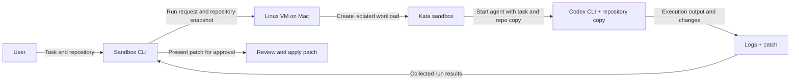
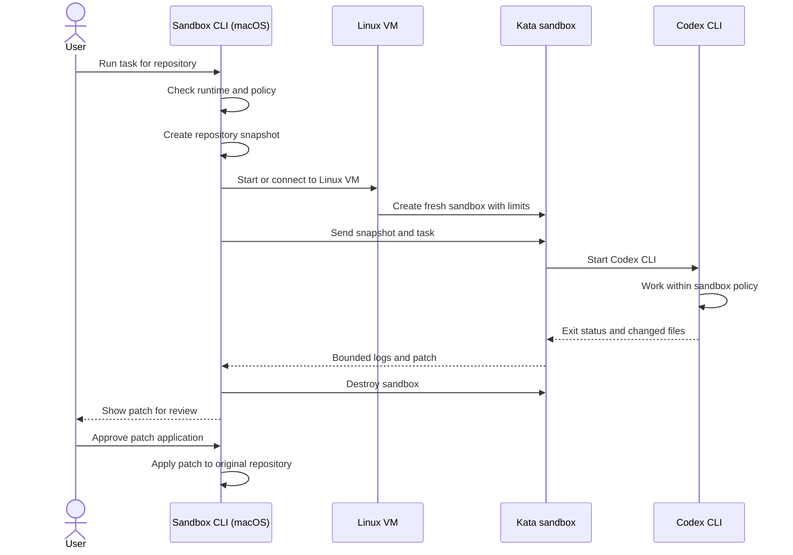

# Local AI Agent Sandbox: System Design

**Status:** Initial design, suitable for an MVP discussion  
**Primary host:** macOS on Apple silicon  
**First harness:** Codex CLI  
**Preferred isolation runtime:** Kata Containers inside Linux, subject to a host feasibility check

## 1. Goal

Run a coding agent against a user-selected repository and task in a disposable environment. The agent should only see the files, credentials, network routes, and resources explicitly granted to that run. When it finishes, the user reviews and applies the resulting patch on the host.

The runtime is responsible for enforcing the boundary. The agent's own instructions, tool permissions, or claims that it will stay within bounds are not treated as enforcement.

## 2. MVP boundary

### Included

- Local CLI on macOS.
- One isolated run at a time.
- One repository snapshot and one user-supplied task per run.
- Codex CLI as the first harness, behind a small harness adapter interface.
- Disposable Linux guest and Kata workload when Kata is supported by the chosen Linux VM setup.
- Explicit CPU, memory, disk, timeout, filesystem, and network policy for every run.
- Capture stdout/stderr, exit status, and a patch for review.
- Destroy the guest/workload after collecting results.

### Deferred

- Multiple concurrent jobs, hosted execution, team accounts, web UI, persistent workspaces, arbitrary harnesses, and a general policy language.
- Claiming that Kata on macOS is supported until the nested virtualization and Kata checks pass on the actual machine and VM stack.

## 3. Architecture



In 12 lines, the architecture is:

1. The user submits a coding task and selects a repository.
2. The macOS CLI validates the request and sandbox policy.
3. The CLI creates a repository snapshot for this run.
4. The CLI starts or connects to a Linux VM on the Mac.
5. The Linux VM hosts containerd and the Kata runtime.
6. Kata creates a fresh, resource-limited sandbox VM.
7. The CLI sends the task and repository snapshot into the sandbox.
8. The Codex CLI runs inside the sandbox with only granted access.
9. Filesystem access is limited to the copied repository and declared inputs.
10. Network access follows the run policy, which is deny-by-default.
11. The CLI collects bounded logs and a patch, then destroys the sandbox.
12. The user reviews the patch before the CLI applies it to the original repository.

On macOS, this is a layered virtualization stack: **macOS → Linux VM → Kata VM → agent workload**. Kata's usual Linux host requirements and the nested virtualization path must be verified. Apple provides a Virtualization framework for Linux VMs on Apple silicon, but that alone does not establish that the Linux guest exposes the virtualization interface Kata needs. The local runtime should detect and report this explicitly rather than silently fall back to weaker isolation.

If nested Kata is unavailable, the initial product can still be developed with the runtime interface and a clearly labeled development backend. That backend must not be presented as equivalent to the Kata security boundary. The production-quality isolated path can run on a Linux host with Kata.

### Single-run sequence



## 4. Main components

### Local CLI and run coordinator

Python is the recommended MVP control plane because it keeps orchestration, policy validation, snapshot handling, and CLI iteration straightforward. Keep the VM and container operations behind interfaces so implementation details can change without changing the user command.

Responsibilities:

- Validate the host and runtime before accepting a run.
- Resolve the repository root and reject paths outside it.
- Create a run ID and immutable run configuration.
- Build a minimal input bundle, launch the guest workload, stream logs, enforce timeout/cancellation, collect outputs, and clean up.
- Never interpret agent output as control-plane instructions.

### Host VM manager

Creates and destroys the Linux VM that hosts containerd and Kata on macOS. It owns the VM image lifecycle, resource limits, and a narrow host/guest communication channel. Avoid general host filesystem sharing into the guest; pass only the per-run input bundle and receive only declared outputs.

VM backend is an implementation choice behind `VmProvider`. First investigate Apple Virtualization framework based Linux VM options and verify nested virtualization on this M4 machine. If that path fails, use a Linux machine for the Kata runtime rather than implying a local Kata run succeeded.

### Guest runtime manager

Within the Linux guest, containerd invokes the Kata runtime to create a fresh workload VM for each run. Pin guest image, Kata version, kernel, and agent image by digest/version. The workload gets no host container socket, privileged mode, host PID/network namespace, or unnecessary devices.

### Harness adapter

The first adapter launches Codex CLI using a fixed executable and argument construction, not a shell string. It provides the task through a controlled input channel and streams output as data. The adapter owns harness-specific setup and result extraction; sandbox enforcement remains outside the adapter.

Define a narrow contract such as:

```text
prepare(run_config) -> workload_spec
execute(workload_handle, task) -> exit_status
collect(workload_handle) -> logs, patch, metadata
```

Later harnesses implement the same contract without changing isolation policy or lifecycle management.

### Policy and boundary enforcement

MVP policy is a typed configuration with safe defaults, not a user-editable arbitrary shell script. Enforce it at the VM/workload boundary:

- **Filesystem:** copy a repository snapshot into the guest; expose only that snapshot as writable. Do not mount the user's home directory, SSH directory, cloud credentials, Docker socket, or host root. Return a patch, not direct writes to the original checkout.
- **Network:** default deny, with an explicit opt-in policy. If network is enabled, route traffic through a guest/host-controlled proxy with destination rules and logs. Do not rely on DNS filtering alone. Start with either no network or a narrow allowlist required for model service and package access.
- **Credentials:** never copy the user's general Codex or cloud credential files into the guest. Determine the supported Codex authentication flow before implementation. If a credential must be supplied, use a short-lived, per-run token through a narrow broker/proxy; do not expose it to arbitrary child processes unless the security design accepts that risk.
- **Resources:** set vCPU, RAM, disk quota, process limits where applicable, wall-clock timeout, and output-size limits.
- **Lifecycle:** on success, failure, timeout, or cancellation, terminate the workload and remove its writable disk/state. Preserve only declared logs and patch artifacts.

## 5. Run lifecycle

1. User invokes `agent-sandbox run --repo ./project --task "..."`.
2. CLI checks runtime availability and displays the effective policy. It fails closed if the requested Kata backend is unavailable.
3. Snapshot the selected repository into a per-run bundle. Exclude `.git` internals and common secret/config paths by default; allow explicit, reviewed additions. Record the source commit when available.
4. Start or reuse a trusted Linux host VM, then create a fresh Kata workload with pinned images and resource limits.
5. Transfer the snapshot and task into the workload over a narrow channel.
6. Launch Codex CLI. Apply the configured filesystem and network policy for the entire run.
7. Stream bounded logs and enforce timeout/cancellation.
8. Collect a patch and run metadata; validate that patch paths remain within the snapshot root.
9. Destroy the per-run Kata VM and its writable state. Shut down the Linux VM when idle according to local policy.
10. Show the patch for review. Applying it to the original repository is a separate, explicit user action.

## 6. Trust boundaries

```text
Untrusted: task text, repository contents, agent process, tools invoked by the agent,
           generated output, network responses

Trusted only after verification: host CLI, VM image source, guest image, pinned runtime,
                                policy implementation, patch path validator
```

Repository files and task text can contain prompt injection. Treat all content read by the harness as untrusted. A compromised agent must not gain control of the host coordinator through logs, filenames, patch metadata, or guest communication. Keep the guest control channel structured and narrow; do not expose a host shell or general-purpose RPC.

## 7. Key design decisions

| Decision | MVP choice | Reason |
|---|---|---|
| Control plane | Python CLI | Fast iteration; clear boundaries around VM/runtime adapters |
| First host | macOS Apple silicon | Matches user's local machine |
| Isolation runtime | Kata in Linux guest, gated on feasibility | Stronger boundary from a separate guest kernel; Mac nested support is not assumed |
| Repo exchange | Snapshot in, patch out | Avoids giving the guest a live host mount or direct write access |
| Network | Deny by default; explicit opt-in | Network access can leak data and download untrusted code |
| Harness | Codex adapter first | Focused MVP while keeping the runtime harness-neutral |
| Patch application | User-reviewed host operation | Agent cannot alter the original checkout directly |

## 8. Feasibility gate for this Mac

Before treating local Kata as the MVP execution path, run a throwaway Linux VM experiment and confirm all of the following:

1. The selected VM provider runs a Linux ARM64 guest on the M4.
2. Nested virtualization is exposed inside that guest.
3. The guest has the required virtualization device/interface and Kata's required kernel facilities.
4. A minimal Kata workload starts and reports a guest kernel distinct from the Linux host VM kernel.
5. Resource limits, networking, and file exchange behave as configured.

Apple's Virtualization framework supports Linux VMs on Apple silicon; Kata's Linux installation guidance requires hardware virtualization and supports nested execution only when the underlying hypervisor exposes it. The actual combination needs a hands-on check. If any check fails, keep the architecture and develop against a clearly marked mock/dev backend while running real Kata tests on a Linux host.

## 9. Initial interface sketch

```text
agent-sandbox doctor
agent-sandbox run --repo PATH --task TEXT [--network off|allowlist]
agent-sandbox show RUN_ID
agent-sandbox apply RUN_ID
agent-sandbox clean [RUN_ID]
```

`doctor` reports the host OS/architecture, VM provider, nested virtualization status, Kata status, configured resource limits, and whether execution is truly using Kata. `run` prints the effective policy before starting. Run artifacts live in an application-owned directory, not inside the user's repository.

## 10. MVP acceptance criteria

- A run can only read/write the selected repository snapshot and explicitly supplied inputs.
- The original repository remains unchanged until the user applies the returned patch.
- A Kata-backed run is identified as such only after a runtime check confirms it.
- No network is available unless the user enabled a network policy.
- Credentials and host sockets are not mounted into the workload by default.
- Timeout, cancellation, and errors all trigger cleanup.
- Logs and patches are bounded, associated with a run ID, and inspectable by the user.
- A runtime failure never causes an automatic fallback to a weaker isolation mode.

## References

- [Kata Containers installation and prerequisites](https://github.com/kata-containers/kata-containers/blob/main/docs/installation.md)
- [Kata Containers virtualization architecture](https://github.com/kata-containers/kata-containers/blob/main/docs/design/virtualization.md)
- [Apple Virtualization framework](https://developer.apple.com/documentation/virtualization)
